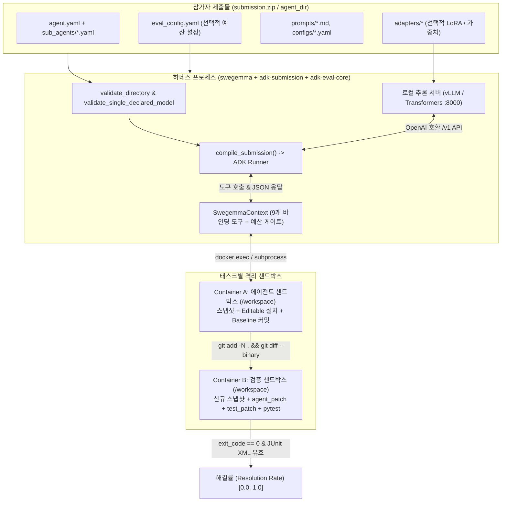
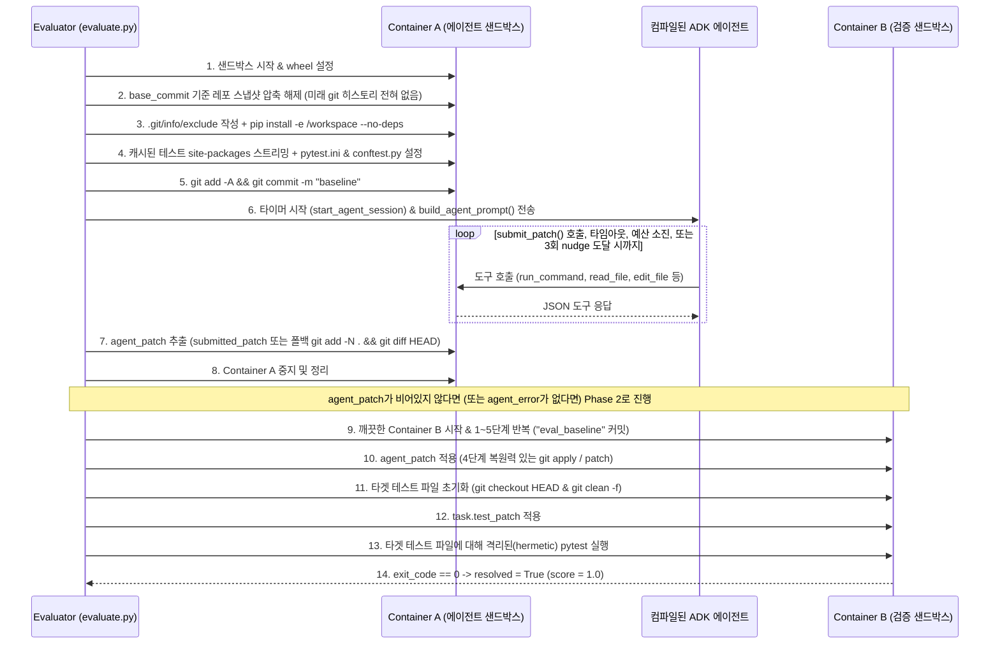

# `swegemma` 평가 하네스(Evaluation Harness) 및 참가자 가이드

이 문서는 **`swegemma`** 평가 하네스와 함께 동작하는 동반 라이브러리(**`adk-submission`** 및 **`adk-eval-core`**)에 대한 전체 기술 레퍼런스를 제공합니다. 참가자의 제출물이 어떻게 검증되고 컴파일되는지, 하네스가 에이전트 세션과 샌드박스를 어떻게 오케스트레이션하는지, 내장 도구(Built-in Tools)들이 어떻게 동작하는지, 그리고 생성된 패치가 어떻게 추출되고 채점되는지 설명합니다.

---

## 목차 (Table of Contents)

1. [시스템 아키텍처 및 라이브러리 스택](#1-시스템-아키텍처-및-라이브러리-스택)
2. [제출 규약 및 선언형 에이전트 스키마 (`adk-submission`)](#2-제출-규약-및-선언형-에이전트-스키마-adk-submission)
3. [모델 레지스트리, 단일 모델 규칙 및 4x L4 GPU 환경의 LoRA 어댑터](#3-모델-레지스트리-단일-모델-규칙-및-4x-l4-gpu-환경의-lora-어댑터)
4. [2단계(Two-Phase) 평가 라이프사이클](#4-2단계two-phase-평가-라이프사이클)
5. [하네스-에이전트 상호작용 프로토콜](#5-하네스-에이전트-상호작용-프로토콜)
6. [내장 도구(Built-In Tools) 레퍼런스 (`swegemma.tools`)](#6-내장-도구built-in-tools-레퍼런스-swegemmatools)
7. [예산(Budgets), 운영 제한 및 컨텍스트 관리](#7-예산budgets-운영-제한-및-컨텍스트-관리)
8. [패치 추출 및 Phase 2 검증 (`verify_task`)](#8-패치-추출-및-phase-2-검증-verify_task)
9. [로컬 CLI 사용법 및 출력 아티팩트](#9-로컬-cli-사용법-및-출력-아티팩트)
10. [참가자 모범 사례(Best Practices) 및 주요 주의사항](#10-참가자-모범-사례best-practices-및-주요-주의사항)

---

## 1. 시스템 아키텍처 및 라이브러리 스택

평가 스택은 상호 협력하는 3개의 라이브러리로 구성됩니다:

| 패키지 | 대회 스택에서의 역할 |
| :--- | :--- |
| **`adk-submission`** | **선언형 에이전트 컴파일러 & 추론 서버 매니저.** 신뢰할 수 없는(untrusted) 제출 디렉터리(`agent.yaml`, 프롬프트, 서브 에이전트, 스킬, PEFT/LoRA 어댑터)를 참가자의 임의 Python 코드를 실행하지 않고(`importlib`를 절대 사용하지 않음) 실제 Google ADK `BaseAgent` 트리로 컴파일(`compile_submission`)합니다. 또한 로컬 `VllmServer` 및 `TransformersServer` 프로세스를 관리합니다. |
| **`adk-eval-core`** | **핵심 평가 인프라.** 기본 태스크/결과 모델(`BenchmarkTask`, `BaseTaskResult`, `EvaluationResult`), 샌드박스 실행 백엔드(`DockerContainer`, `SubprocessSandbox`), 복원력 있는 3단계 파일 편집 엔진(`apply_replacement`), 토큰/비용 추적(`TokenBudget`, `PricingTable`), ADK 플러그인(`EventDisplayPlugin`, `ModelRetryPlugin`), 그리고 ATIF v1.7 궤적 추적(`SessionTrace`) 기능을 제공합니다. |
| **`swegemma`** | **SWE-bench 하네스 & 채점 엔진.** 2-컨테이너 기반의 SWE 평가 라이프사이클(`Evaluator`, `run_agent_sandbox`, `verify_task`)을 구현하고, 9개의 샌드박스 워크스페이스 및 코드 인텔리전스 도구를 바인딩(`SwegemmaContext.create_tools()`)하며, 태스크 프롬프트와 작업 재개 유도 메시지(continuation nudges)를 생성하고, 통합 git diff를 추출(`scripts/inference.py`)한 뒤 격리된(hermetic) `pytest` + JUnit XML 검증(`scripts/metric.py`)을 수행합니다. |



---

## 2. 제출 규약 및 선언형 에이전트 스키마 (`adk-submission`)

### 2.1. 선언형 전용(Declarative-Only) 보안 모델
참가자는 Python 코드 엔트리포인트(`agent.py` 또는 `agent_fn`)를 제출하지 **않습니다**. 표준 ADK의 `from_config()`는 임의의 동적 Python 임포트를 허용하지만, **`adk-submission`은 이를 샌드박싱된 YAML 컴파일러(`compile_submission`)로 대체**합니다. 모든 에이전트, 서브 에이전트, 워크플로우, 도구 및 생성 파라미터는 YAML로 선언되며, 닫힌(closed) 호스트 레지스트리(`ToolRegistry`, `ModelRegistry`, `SkillRegistry`, `CallbackRegistry`)를 통해서만 해석됩니다.

### 2.2. 제출 디렉터리 구조
유효한 제출 디렉터리(`submission.zip`의 루트에 패키징되며, Stage 1에서 `scripts/inference.py`에 의해 평가되어 `submission.parquet`를 생성함)는 다음 구조를 따릅니다:

```text
submission/
├── agent.yaml                  # 필수(REQUIRED): 루트 에이전트 설정 (또는 root_agent.yaml; .yml도 허용)
├── eval_config.yaml            # 선택: 태스크별 평가 예산 및 타임아웃 오버라이드
├── configs/
│   └── sampling.yaml           # 선택: !include를 통해 로드되는 생성 파라미터
├── prompts/
│   ├── system.md               # 선택: !include를 통해 로드되는 시스템 지침(instruction)
│   └── analyzer.md
├── sub_agents/
│   └── code_analyzer.yaml      # 선택: 서브 에이전트 또는 AgentTool YAML 설정
├── adapters/                   # 선택: 파인튜닝된 PEFT LoRA 어댑터 또는 모델 가중치
│   ├── main_lora/
│   │   ├── adapter_config.json
│   │   └── adapter_model.safetensors
│   └── tool_lora/
│       ├── adapter_config.json
│       └── adapter_model.safetensors
└── skills/                     # 선택: ADK Skill 디렉터리 (각 폴더에 SKILL.md 포함)
    └── repo_navigation/
        └── SKILL.md
```

- **루트 설정 탐색 (Root Config Discovery)**: 제출 루트에는 정확히 하나의 루트 설정 파일(`agent.yaml`, `agent.yml`, `root_agent.yaml`, 또는 `root_agent.yml`)이 존재해야 합니다. 루트 파일이 없으면 `MissingRootConfigError`가 발생하고, 2개 이상이면 `MultipleRootConfigsError`가 발생합니다.
- **선택적 평가 예산 설정 (`eval_config.yaml`)**: 제출물 루트에 `evaluation:` 키(`timeout_seconds`, `max_tool_calls`, `max_time_minutes`, `max_turns`)를 포함하는 `eval_config.yaml`을 선택적으로 포함하여 Stage 1 추론 시 태스크별 운영 예산을 커스터마이징할 수 있습니다(`scripts/inference.py`의 `load_submission_eval_config`).
- **샌드박싱된 `!include` 지시자**: YAML 파일은 `!include <상대_경로>`를 사용해 외부 파일을 임베딩할 수 있습니다:
  - `.md` 및 `.txt` 파일은 원시 UTF-8 문자열로 로드됩니다(`instruction` 또는 `global_instruction`에 이상적).
  - `.yaml` 및 `.yml` 파일은 재귀적으로 파싱됩니다(순환 참조 감지 포함 최대 include 깊이 `10`).
  - 절대 경로, 널 바이트(null bytes), `..` 상위 경로 이동 컴포넌트, 그리고 제출 루트 외부로 연결되는 심볼릭 링크는 엄격히 차단됩니다(`PathTraversalError`).

### 2.3. 지원되는 에이전트 클래스 (`agent_class`)
`SandboxedAgentConfig`는 4가지 에이전트 타입을 지원합니다(`agent_class`를 생략하면 기본값은 `LlmAgent`입니다):

1. **`LlmAgent` (기본값)**:
   - `name` (`str`, 필수): 에이전트 식별자 문자열.
   - `model` (`str`, 기본 모델이 설정되지 않은 한 필수): 레지스트리에 등록된 모델 별칭(대회 제출용으로는 `gemma-4-31b-it-qat-w4a16-ct`, `gemma-4-12b-it-qat-w4a16-ct`, `gemma-4-e4b-it-qat-w4a16-ct`, 또는 `gemma-4-e2b-it-qat-w4a16-ct`).
   - `adapter` (`str | None`): `adapters/` 하위의 서브디렉터리 또는 가중치 파일과 일치하는 선택적 어댑터 이름.
   - `description` (`str`, 최대 `1,000,000`자): 부모 에이전트가 이 에이전트에게 작업을 위임할 때 참조하는 설명.
   - `instruction` (`str`, 최대 `1,000,000`자): 에이전트의 시스템 프롬프트. ADK 세션 상태 템플릿 변수(`{problem_description}`, `{hints}`, 또는 커스텀 `output_key` 변수)를 지원합니다.
   - `tools` (`list`): 도구 이름 문자열(`str`), `AgentTool` 참조(`agent_tool: {config_path: ..., skip_summarization: true}`), 또는 인라인 에이전트 딕셔너리의 리스트.
   - `skills` (`list[str] | None`): 제출 아카이브 내 스킬 디렉터리들의 상대 경로 리스트.
   - `sub_agents` (`list`): 멀티 에이전트 제어권 이관(transfer)을 위한 `{config_path: ...}` 참조 리스트.
   - `output_key` (`str | None`): 에이전트의 최종 텍스트 출력을 `session.state[output_key]`에 저장합니다.
   - `include_contents` (`"default" | "none"`): 대화 히스토리를 에이전트에 전달할지 여부를 제어합니다.
   - `disallow_transfer_to_parent` / `disallow_transfer_to_peers` (`bool | None`).
   - `generate_content_config` (`dict | None`): 샘플링, 시드(seed), 그리고 추론(thinking) 파라미터(아래 제약 조건 참고).
2. **`SequentialAgent`**:
   - `sub_agents`를 순차적으로 실행합니다. `name`, `description`, `sub_agents`, 에이전트 콜백을 받습니다.
3. **`ParallelAgent`**:
   - 격리된 브랜치에서 `sub_agents`를 동시에(concurrently) 실행합니다. `name`, `description`, `sub_agents`, 에이전트 콜백을 받습니다.
4. **`LoopAgent`**:
   - `sub_agents`를 최대 `max_iterations`(`int`, 기본값 `500`, 허용 범위 `1..500`)까지 반복 실행합니다.

### 2.4. 강제되는 구조적 제한 및 생성 제약 조건
`swegemma`의 제출 제약 조건(`swegemma/config.py`의 `build_submission_limits()`)은 의도적으로 최소화되어 있습니다. **보안 샌드박싱(심볼릭 링크 금지, 경로 이탈 금지, 선언형 YAML만 허용) 외에 가장 중요한 하드 제약 조건은 모든 `adapters/` 가중치를 포함해 압축 해제 후 전체 제출물 크기가 `< 3 GiB`(`3,221,225,472` 바이트) 미만이어야 한다는 점**과, 4x L4 GPU 컨텍스트 윈도우(`32,768` 토큰)에 의해 요구되는 토큰 상한선입니다.

그 외의 모든 구조적 제한은 무한 재귀나 zip/YAML 앵커 폭탄(anchor bombs)을 방지하기 위한 넉넉한 안전 상한선으로만 설정되어 있습니다:

| 카테고리 | 파라미터 | 대회 제한 / 허용 범위 |
| :--- | :--- | :--- |
| **주요 아카이브 제약** | **`max_total_size_bytes`** | **`3 GiB` (`adapters/`를 포함한 압축 해제 후 총 크기 `3,221,225,472` 바이트)** |
| **구조적 안전 상한선 (`SubmissionLimits`)** | `max_file_count` | 파일 `10,000`개 |
| | `max_yaml_files` | YAML 파일 `1,000`개 |
| | `max_yaml_size_bytes` | YAML 파일당 / 누적 `!include` 확장 후 `50 MiB` |
| | `max_skill_size_bytes` | 스킬 디렉터리당 `50 MiB` |
| | `max_instruction_chars` | 에이전트당 `1,000,000`자 (전체 에이전트 합산 최대 `10,000,000`자) |
| | `max_agents` | 컴파일된 트리 내 총 에이전트 `500`개 |
| | `max_sub_agent_depth` | 중첩 깊이 `50`단계 (`sub_agents` 및 `agent_tool`) |
| | `max_skills` | 스킬 `1,000`개 |
| | `max_loop_iterations` | 모든 `LoopAgent`에 대해 최대 `500`회 반복 |
| | `allowed_file_extensions` | 엄격히 필요한 포맷만 허용: `.yaml`, `.yml`(에이전트/평가 설정), `.md`, `.txt`(프롬프트 & `SKILL.md`), `.py`(ADK 스킬 스크립트), `.json`(`adapter_config.json`), `.safetensors`(`adapter_model.safetensors`). Pickle 기반 가중치(`.bin`, `.pt`, `.pth`) 및 기타 바이너리/아카이브 확장자는 거부됩니다. |
| | `adapter_extensions` | `.safetensors`만 허용 (`adapters/<name>/adapter_model.safetensors`) |
| **생성 설정 (`GenerationConstraints`)** | `allowed_fields` | **모든 스키마 필드 허용**: `temperature`, `top_p`, `top_k`, `max_output_tokens`, `presence_penalty`, `frequency_penalty`, `stop_sequences`, `response_mime_type`, `seed`, `thinking_config` |
| | `max_output_tokens` | `1` ~ `32,768` (기본값 `16,384`; 4x L4 vLLM의 `max_model_len=32768`에 의해 제한됨) |
| | `thinking_config.thinking_budget` | `0` ~ `32,768` (기본값 `4,096`; 4x L4 vLLM의 `max_model_len=32768`에 의해 제한됨; 양수 값은 `enable_thinking: true`를 설정하고 vLLM의 `ThinkingTokenBudgetLogitsProcessor`에 `extra_body.thinking_token_budget`을 전달하며, `0`은 `enable_thinking: false`로 설정함) |
| | `thinking_config.thinking_level` | `"MINIMAL"`, `"LOW"`, `"MEDIUM"`, `"HIGH"`, 또는 `"NONE"` (대소문자 무관). *참고*: vLLM의 OpenAI 호환 `/v1` 엔드포인트를 통해 서빙할 때(특히 LoRA 어댑터 사용 시), `thinking_level`은 OpenAI의 `reasoning_effort` 파라미터로 매핑되므로(`swegemma`는 `litellm.drop_params = True`도 설정함) `thinking_level`은 생략하고 대신 `include_thoughts: true` + `thinking_budget: 4096`을 설정하세요. |
| | `thinking_config.include_thoughts` | `true` 또는 `false`. `thinking_budget > 0`(또는 `thinking_level` 활성화)일 때, `include_thoughts: true`는 `LlmResponse` 및 이후 도구 호출 컨텍스트에 `Part(thought=True)`(`<\|channel>thought...<channel\|>`)를 유지하는 반면, `include_thoughts: false`는 현재 턴에서의 추론은 활성화(`enable_thinking: true`)하되 `LlmResponse`와 발신 메시지 히스토리에서 `Part(thought=True)`를 제거합니다. `thinking_budget`과 `thinking_level`이 모두 설정되지 않은 경우, `include_thoughts`는 `enable_thinking`의 폴백 토글로 작동합니다. |
| | `temperature` / `top_p` / `top_k` / penalties / `seed` / `stop_sequences` | 제한 없음 (유효한 모든 스키마 값 허용; `temperature >= 0.0`, `0.0 <= top_p <= 1.0`, `top_k >= 1`; `seed`는 LiteLLM/vLLM으로 가는 요청 본문에 전달됨) |

> [!WARNING]
> 샌드박스를 우회하여 실행 방식을 변경하는 ADK 필드(`generate_content_config` 내부의 `tools`, `system_instruction`, `http_options`, `safety_settings`, 또는 `response_schema`)는 스키마 설계상 `GenerateContentConfig`에서 제외되어 있으며 설정 시 검증 오류(validation error)가 발생합니다.

---

## 3. 모델 레지스트리, 단일 모델 규칙 및 4x L4 GPU 환경의 LoRA 어댑터

### 3.1. 연산 환경: 4x NVIDIA L4 GPUs (총 96 GB VRAM)
대회 평가 환경은 **4 × NVIDIA L4 GPU**가 장착된 전용 머신에서 실행됩니다:
- **GPU당 메모리**: `24 GB GDDR6` (4개 GPU 합산 총 `96 GB` VRAM).
- **vLLM 서빙 설정 (`scripts/inference.py`의 `setup_vllm_server`)**:
  - `tensor_parallel_size = 4` (모델 가중치와 KV 캐시를 4개의 L4 GPU 전체에 샤딩)
  - `gpu_memory_utilization = 0.90` (GPU당 약 `21.6 GB` 사용 가능 / 4개 GPU 합산 약 `86.4 GB` 사용 가능)
  - `max_model_len = 32768` (프롬프트 + 추론 + 출력 컨텍스트를 합친 최대 길이 `32,768` 토큰)
  - `scheduler_reserve_full_isl = False`
  - `enable_auto_tool_choice = True`, `tool_call_parser = "gemma4"`, `reasoning_parser = "gemma4"`, `reasoning_config = {"reasoning_start_str": "<|channel>", "reasoning_end_str": "<channel|>"}`
  - 탐색된 어댑터에 따른 동적 LoRA 크기 조정: `enable_lora = bool(adapter_map)`, `max_loras = max(1, len(adapter_map))`, `max_lora_rank = max(detected_ranks) if detected_ranks else 128`
  - 모델별 CLI 플래그 (`MODEL_VLLM_EXTRA_ARGS`): `gemma-4-12b-it-qat-w4a16-ct`의 경우 `--hf-overrides '{"architectures": ["Gemma4ForCausalLM"], "model_type": "gemma4"}'`를 전달합니다.

| 베이스 모델 변형(Variant) | 가중치 정밀도 | 대략적인 가중치 메모리 점유량 (4 GPUs) | 대회 허용 상태 |
| :--- | :--- | :--- | :--- |
| **`gemma-4-31b-it-qat-w4a16-ct`** *(스타터 킷 기본값)* | W4A16 (INT4 양자화) | `~16–18 GB` (`~4.5 GB / GPU`) | **Kaggle 대회 제출 허용** (`ALLOWED_MODEL_NAMES`) |
| **`gemma-4-12b-it-qat-w4a16-ct`** | W4A16 (INT4 양자화) | `~6–8 GB` (`~1.8 GB / GPU`) | **Kaggle 대회 제출 허용** (`ALLOWED_MODEL_NAMES`) |
| **`gemma-4-e4b-it-qat-w4a16-ct`** | W4A16 (INT4 양자화) | `~3–4 GB` (`~1.0 GB / GPU`) | **Kaggle 대회 제출 허용** (`ALLOWED_MODEL_NAMES`) |
| **`gemma-4-e2b-it-qat-w4a16-ct`** | W4A16 (INT4 양자화) | `~2–3 GB` (`~0.7 GB / GPU`) | **Kaggle 대회 제출 허용** (`ALLOWED_MODEL_NAMES`) |
| **`gemma-4-31b-it` / `gemma-4-27b-it` / `gemma-4-26b-a4b-it` / `gemma-4-12b-it` / `gemma-4-9b-it` / `gemma-4-e4b-it` / `gemma-4-e2b-it`** | `bfloat16` | `~4–62 GB` | 로컬 CLI 평가 전용으로 `models.yaml` / `_build_cli_model_registry()`에 등록됨 |

이 4x L4 하드웨어 예산은 다음 4가지 운영 규칙을 직접적으로 결정합니다:
1. **제출물당 단일 베이스 모델 규칙 (`ALLOWED_MODEL_NAMES`)**: 대회 제출물 내의 모든 에이전트는 공식 양자화 모델 4종(`gemma-4-31b-it-qat-w4a16-ct`, `gemma-4-12b-it-qat-w4a16-ct`, `gemma-4-e4b-it-qat-w4a16-ct`, `gemma-4-e2b-it-qat-w4a16-ct`) 중 단 하나의 선언된 베이스 모델을 공유해야 합니다.
2. **컨텍스트 윈도우 상한선 (`32,768` 토큰)**: `max_output_tokens`와 `thinking_budget`은 vLLM의 `max_model_len=32768`에 맞춰 `32,768` 토큰을 초과할 수 없습니다.
3. **압축 해제 후 총 제출물 크기 (`adapters/` 포함 `< 3 GiB`)**: `/kaggle/working/submission`으로의 빠른 압축 해제를 보장하고, 제출된 LoRA 어댑터가 호스트 디스크 및 GPU LoRA 버퍼(`max_lora_rank <= 128`) 내에 들어맞도록 보장합니다.
4. **호스트 컨테이너 샌드박싱 (컨테이너당 `4 GiB` RAM / `2 vCPUs`)**: `Container A`와 `Container B` 내부의 레포지토리 테스트 스위트가 vLLM 엔진에 필요한 호스트 CPU나 시스템 RAM을 고갈시키는 것을 방지합니다.

### 3.2. 단일 베이스 모델 규칙 (The Single Base Model Rule)
추론 서버를 시작하기 전에, `validate_single_declared_model(agent_dir)`(`scripts/inference.py`, `adk_submission.discovery.discover_declared_models`를 래핑함)는 루트 `agent.yaml`, 참조된 모든 `sub_agents[*].config_path`, 모든 `tools[*].agent_tool.config_path`, 그리고 제출 디렉터리 내의 모든 독립 실행형 에이전트 YAML 파일을 순회합니다.
- 프로바이더 접두사(`openai/`, `google/`, `hosted_vllm/`, `custom/`)는 제거됩니다(`normalize_model_name`).
- **제출물 내의 모든 에이전트는 최대 단 하나의 고유한 베이스 모델만 선언해야 하며**(`len(models) == 1`), Kaggle 대회 채점(`scripts/inference.py`)에서 해당 모델은 반드시 `ALLOWED_MODEL_NAMES`(`gemma-4-31b-it-qat-w4a16-ct`, `gemma-4-12b-it-qat-w4a16-ct`, `gemma-4-e4b-it-qat-w4a16-ct`, `gemma-4-e2b-it-qat-w4a16-ct`)에 속해야 합니다. 여러 베이스 모델을 선언하거나 허용되지 않은 모델을 선언하면 `ParticipantVisibleError`가 발생합니다.

### 3.3. 사전 등록된 모델 별칭(Aliases) 및 라우팅
`models.yaml`과 `_build_cli_model_registry()`(`src/swegemma/cli.py`)는 `ModelRegistry`에 다음 Gemma 4 별칭들을 등록합니다:
- `gemma-4-31b-it-qat-w4a16-ct`, `gemma-4-12b-it-qat-w4a16-ct`, `gemma-4-e4b-it-qat-w4a16-ct`, `gemma-4-e2b-it-qat-w4a16-ct` (공식 양자화 대회 모델)
- `gemma-4-31b-it`, `gemma-4-31b`
- `gemma-4-27b-it`, `gemma-4-27b`
- `gemma-4-26b-a4b-it`, `gemma-4-26b-a4b`, `diffusiongemma-26b-a4b-it`
- `gemma-4-12b-it`, `gemma-4-12b`
- `gemma-4-9b-it`, `gemma-4-9b`
- `gemma-4-e4b-it`, `gemma-4-e4b`
- `gemma-4-e2b-it`, `gemma-4-e2b`

채점 하네스가 로컬 추론 서버(`scripts/inference.py`의 `setup_vllm_server`, `127.0.0.1:8000`에서 `tool_call_parser='gemma4'`, `reasoning_parser='gemma4'`, `max_model_len=32768` 옵션으로 `VllmServer` 실행)를 시작할 때, `server_instance.create_model_registry(...)`(또는 이미 활성화된 엔드포인트에 연결할 경우 폴백 `LiteLlm(..., num_retries=3)`)를 통해 선언된 모델 별칭(및 발견된 모든 어댑터 이름)을 `LiteLlm(model=f"openai/{served_model}", api_base="http://127.0.0.1:8000/v1")`에 바인딩하고 LiteLLM 추론 패치(`install_litellm_reasoning_patch()`)를 설치합니다.

### 3.4. 멀티 LoRA 서빙 (`adapters/`) 및 용량 설계 가이드라인
제출물이 단일 베이스 모델로 제한되더라도, **계층 구조 내의 서로 다른 에이전트들은 각기 다르게 파인튜닝된 LoRA 어댑터를 사용할 수 있습니다**:
1. PEFT LoRA 디렉터리(`adapter_config.json` 및 `adapter_model.safetensors` 포함)를 `adapters/<adapter_name>/` 내부에 배치합니다. 어댑터 이름은 `[A-Za-z0-9][A-Za-z0-9._-]*` 정규식과 일치해야 합니다.
2. `agent.yaml` 또는 `sub_agents/*.yaml`의 모든 `LlmAgent`에서 `adapter: <adapter_name>`을 참조합니다(예: 루트 코더 에이전트에는 `adapter: main_lora`를, 읽기 전용 분석기 `AgentTool`에는 `adapter: tool_lora`를 지정).
3. `discover_adapters()`는 발견된 모든 어댑터를 vLLM 서버에 자동으로 등록하며, `enable_lora = bool(adapter_map)`, `max_loras = max(1, len(adapter_map))`, `max_lora_rank = max(detected_ranks) if detected_ranks else 128`(`--lora-modules name1=path1 name2=path2 ...` 옵션으로 전달됨)을 자동으로 맞춰 설정하고, `resolve_swegemma_adapter`(`src/swegemma/harness/agent_runner.py`)가 각 에이전트의 요청을 해당 `openai/<adapter_name>` 모델 식별자로 라우팅합니다.
4. **어댑터 용량 계획 (총 예산 `< 3 GiB`)**:
   - 모든 선형 프로젝션(`q_proj`, `k_proj`, `v_proj`, `o_proj`, `gate_proj`, `up_proj`, `down_proj`)을 타겟팅하는 `bfloat16` 31B 모델 기준:
     - **Rank `r = 16`**: 어댑터당 `~110–220 MB` (`< 3 GiB` 내에 8개의 특화 어댑터를 여유 있게 탑재 가능).
     - **Rank `r = 32`**: 어댑터당 `~220–450 MB` (`< 3 GiB` 내에 6–8개 어댑터 탑재 가능).
     - **Rank `r = 64`**: 어댑터당 `~450–900 MB` (`< 3 GiB` 내에 3–6개 어댑터 탑재 가능).
     - **Rank `r = 128` (`max_lora_rank`)**: 어댑터당 `~0.9–1.8 GB` (`< 3 GiB` 내에 1–3개의 고랭크 어댑터 탑재 가능).

---

## 4. 2단계(Two-Phase) 평가 라이프사이클

모든 벤치마크 태스크(`Task`)는 **완전히 분리된 2개의 샌드박스 라이프사이클**(에이전트 실행을 위한 `Container A`와 검증을 위한 `Container B`)에서 평가됩니다.



### 4.1. 샌드박스 하드웨어 및 격리 (`ContainerManager` vs `SubprocessManager`)
- **Docker 백엔드 (`--sandbox docker`, 기본값)**:
  - 이미지: `swebench-sandbox:latest`
  - 네트워크: **`network_mode="none"`** (완전한 망분리/에어갭 상태; 인터넷이나 PyPI 접근 불가)
  - 메모리 제한: **`4g`** (`4 GiB`; 이를 초과하는 프로세스는 종료 코드 `137` / `SIGKILL`로 강제 종료됨)
  - CPU 할당량: **2 vCPUs** (`cpu_period=100_000`, `cpu_quota=200_000`)
  - 작업 디렉터리: `/workspace` (`TEST_TMPDIR=/tmp`)
  - 컨테이너 재사용 (`reuse_containers=False` 기본값): 기본적으로 각 단계는 엄격한 격리를 위해 새로운 컨테이너를 생성하고 파기합니다. 만약 웜 풀링(`reuse_containers=True`)이 명시적으로 활성화되면, `/workspace`가 완전히 삭제(`find /workspace -mindepth 1 -maxdepth 1 -exec rm -rf {} +`)되고 `/tmp` 및 `/var/tmp`의 임시 패치/스텁이 제거된 후 컨테이너가 유휴 풀로 반환됩니다.
- **Subprocess 백엔드 (`--sandbox subprocess`, Docker 데몬이 없는 환경에서 사용)**:
  - `workspace/`, `tmp/`, `wheels/`, 그리고 격리된 가상환경 `venv/`를 포함하는 격리된 임시 디렉터리 `swegemma_sandbox_<id>_`를 생성합니다.
  - `/workspace`, `/tmp`, `/wheels`, `/usr/local/bin`에 대한 셸 참조를 샌드박스 디렉터리 경로로 재작성하고 새로운 프로세스 그룹(`start_new_session=True`)에서 명령을 실행하며, 명령 타임아웃 시 전체 프로세스 그룹(`os.killpg(..., signal.SIGKILL)`)을 종료합니다.

### 4.2. 컨테이너 부트스트랩 시퀀스 (`container_setup.py`)
에이전트가 호출되기 전(Container A)과 검증이 실행되기 전(Container B), 하네스는 7단계의 결정론적(deterministic) 설정 과정을 수행합니다:

1. **Wheel 스테이징 (`setup_container_wheels`)**: 샌드박스 내부에 `/wheels`를 준비합니다.
2. **스냅샷 추출 (`extract_snapshot`)**: 레포지토리 `.tgz` 아카이브를 `/workspace`에 압축 해제(또는 중복 제거된 베이스 스냅샷 + 바이너리 패치로부터 재구성)하고 순환 심볼릭 링크를 제거합니다.
   - **미래 Git 히스토리 완전 제거 (Zero Future Git History)**: 레포지토리 스냅샷은 `base_commit`까지의 `git fast-export`를 `main` 브랜치의 새로운 `git fast-import` 레포지토리로 파이핑하여 빌드됩니다. `base_commit` 이후의 커밋들은 `.git` 내에 존재하지 않습니다.
3. **Git 제외 설정 (`setup_git_exclude`)**: 빌드/테스트 아티팩트가 `git diff`를 오염시키지 않도록 `/workspace/.git/info/exclude`에 다음 패턴들을 추가합니다:
   ```text
   __pycache__/
   *.pyc
   .pytest_cache/
   *.egg-info/
   build/
   dist/
   .coverage
   ```
4. **Editable 패키지 설치 (`install_editable_package`)**:
   ```bash
   pip install --no-index --find-links=/wheels --no-build-isolation --no-deps -e /workspace 2>/dev/null || true
   ```
5. **테스트 의존성 설치 (`install_test_dependencies`)**: 캐시된 압축 해제 상태의 site-packages(`<20 MB` 베이스 wheel 및 `>=20 MB` 워크스페이스 임포트 wheel)를 컨테이너 Python 환경으로 스트리밍하고 `/sandbox/setup.py --fast-path <repo>`를 실행합니다.
6. **격리된(Hermetic) 테스트 설정 (`setup_workspace_test_config`)**: 표준화된 `/workspace/pytest.ini`(`anyio` 비활성화 및 하드웨어/디바이스/예제 디렉터리 무시 설정)를 작성하고 `/workspace/conftest.py` 상단에 격리된 테스트 수집 훅(collection hook)을 추가합니다.
7. **베이스라인 커밋 (`setup_baseline_commit`)**:
   ```bash
   cd /workspace && git add -A && git commit -m "baseline" --allow-empty -q
   ```
   > [!IMPORTANT]
   > `setup_workspace_test_config`가 `setup_baseline_commit` *이전에* 실행되기 때문에, 하네스가 생성한 `/workspace/pytest.ini`와 `/workspace/conftest.py`는 `HEAD`(`baseline`)에 커밋됩니다. 태스크에서 요구하지 않는 한 `/workspace/pytest.ini`나 `/workspace/conftest.py`를 삭제하거나 수정하지 **마세요**. 이를 변경하면 `git diff HEAD`에 나타나게 됩니다.

---

## 5. 하네스-에이전트 상호작용 프로토콜

### 5.1. 세션 상태 변수 (Session State Variables)
`run_agent_sandbox`가 ADK 세션(`app_name='swegemma_eval'`, `user_id='eval_user'`)을 생성할 때, `session.state`에 다음 값들을 채웁니다:
- `problem_description`: `task.problem_statement` (`str`)
- `hints`: `task.hints_text.strip()` (`str`, `task.hints_text`가 비어있지 않을 때만 존재)

Google ADK는 `LlmAgent.instruction` 내의 `{변수_이름}` 플레이스홀더를 `session.state`로부터 자동으로 보간(interpolate)하므로, `agent.yaml`이나 서브 에이전트 지침에서 `{problem_description}`을 직접 참조할 수 있습니다.

### 5.2. 초기 사용자 프롬프트 (`build_agent_prompt`)
하네스는 루트 에이전트에게 최대 7개 섹션으로 구성된 구조화된 초기 사용자 메시지를 전송합니다(`_extract_declared_tools(agent)`와 대조하여 선언되지 않은 도구는 절대 안내되지 않도록 도구별 규칙과 섹션을 자동으로 필터링합니다):

1. **태스크 헤더 및 문제 설명 (Task Header & Problem Statement)**:
   ```markdown
   You are evaluating a software engineering task for repository {task.repo}.

   Problem Statement:
   {task.problem_statement}
   ```
2. **힌트 (Hints)** *(`task.hints_text`가 비어있지 않은 경우 포함)*:
   ```markdown
   ## Hints:
   {task.hints_text}
   ```
3. **태스크 예산 (Task Budget)** *(`EvalConfig.budget`의 모든 활성 제한 나열)*:
   ```markdown
   ## Task Budget (Session terminates when any budget is exhausted)
   - Time allowance: 60.0 minutes
   - Tool calls allowance: <N> calls
   - Max loop iterations: <N> turns
   - Cost budget: $<X.XX> USD
   ```
4. **실행 환경 규칙 (Execution Environment Rules)** *(에이전트 계층 구조에 `read_file`이 선언되지 않은 경우 `read_file` 줄/글자 수 제한은 생략됨)*:
   ```markdown
   ## Execution Environment Rules
   - Single command timeout: 300 seconds (commands exceeding this fail without ending the session)
   - Command output limit: 5000 characters
   - File view limit: 150 lines per read_file call
   - File character limit: 10000 characters per read_file call
   - Environment is offline (no network/PyPI access). All repository and test dependencies are ALREADY pre-installed. Do NOT attempt to run pip install or download packages.
   ```
5. **표준 지침 (Standard Instructions `0`–`5`)**:
   - 에이전트에게 엄격히 `/workspace` 하위에서 작업할 것, 기존 코드 컨벤션을 확인할 것, 제출 전 타겟 테스트나 인라인 어설션(assertion)으로 구현을 검증할 것, 완료되면 `submit_patch`를 호출할 것, 그리고 최종 텍스트 완료 응답을 반환할 것을 지시합니다.
   - *샌드박스 내 테스트 참고사항*: 기본적으로 `EvalConfig` 및 `agent_runner.py`에서 `enable_sandbox_testing = True`가 활성화되어 있으므로 Container A 내부에서 `pytest`와 `unittest`를 사용할 수 있으며, 지침 `3`은 `"3. Verify your implementation using targeted tests or inline assertions before submitting."`으로 표시됩니다. (만약 `enable_sandbox_testing`이 명시적으로 `False`로 설정되면, 하네스는 Container A 내부에서 `pytest`와 `unittest`를 마스킹하고 지침 `3`을 인라인 `python3 -c "..."` 어설션을 권장하도록 조정합니다).
6. **코드 인텔리전스 도구 (Code Intelligence Tools)** *(`task.repo`에 대해 100바이트를 초과하는 사전 계산된 그래프 `.json` 및 임베딩 `.npz` 파일이 존재할 때 조건부로 추가되며, 에이전트 계층 구조 전체에 실제로 선언된 그래프/임베딩 도구만 나열함)*:
   ```markdown
   ## Code Intelligence Tools
   This repository has pre-built code graph and embedding data indexed by dotted symbol path (e.g. `pkg.module.Class.method`). Use these tools for fast, targeted navigation:
   - `search_similar_code(query)`: Find functions/classes with similar precomputed embeddings given a symbol name (e.g. `pkg.module.Class.method`, `Class.method`, or `func_name`).
   - `get_code_neighbors(node)`: Find callers and callees of a symbol node (e.g. `pkg.module.Class.method` or `Class.method`).
   - `get_code_subgraph(nodes)`: Get the induced call subgraph connecting a list of symbol nodes.
   ```
7. **워크스페이스 레이아웃 (Workspace Layout)**:
   `/workspace` 내부에서 `find . -mindepth 1 -maxdepth 3`을 실행하여 너비 우선(breadth-first)으로 선택되고 계층적으로 정렬된 최대 200개의 항목을 캡처합니다(숨김 파일/디렉터리, `__pycache__`, `*.pyc`, `*.egg-info`를 제외하고, 깊이 1 아래의 `docs`, `docs_src`, `tests`, `examples`, `benchmarks`와 같은 비패키지 대용량 디렉터리는 가지치기함).

### 5.3. 멀티턴 루프, 도구 오류 복구, 작업 재개 유도(Continuation Nudges) 및 종료
하네스는 외부 `while True:` 루프(`agent_runner.py`)에서 루트 에이전트를 구동합니다:
- **도구 오류 복구 (`ToolErrorPlugin` & 스킬 인자 타입 자동 변환)**:
  - `ToolErrorPlugin`은 ADK `App`에 `on_tool_error_callback`을 등록하여, 선언되지 않았거나 환각(hallucinated)된 도구 호출 또는 런타임 도구 예외가 발생할 때 태스크를 중단시키는 대신 구조화된 에러 딕셔너리(`{"status": "error", "error_type": "<ExcName>", "error": "<Message>"}`)로 모델에 반환합니다.
  - `ToolErrorPlugin.before_tool_callback`과 `_wrap_skill_toolset_tools` 모두 ADK `SkillToolset` 도구(`load_skill`, `load_skill_resource`, `run_skill_script`)의 `skill_name` 및 `file_path`에 대해 단일 요소 리스트 문자열(`["name"]` $\to$ `"name"`)을 자동으로 문자열로 강제 변환(coerce)합니다.
- **`submit_patch()` 호출 시 즉시 종료**:
  - `runner.run_async(...)` 도중 에이전트가 `submit_patch()`를 호출하면 `context.patch_submitted`가 `True`가 됩니다.
  - 에이전트가 최종 텍스트 응답(`is_final_response()`)을 방출하거나 `context.patch_submitted == True`인 상태로 현재 `run_async` 턴을 마치면, **하네스는 즉시 에이전트 루프를 탈출**하여 패치 추출 및 Phase 2 검증으로 넘어갑니다.
- **작업 재개 유도 메커니즘 (Continuation Nudge Mechanism, `max_nudges = 3`)**:
  - 만약 `submit_patch()`가 호출되지 **않은** 상태에서 ADK 턴이 종료되고(예를 들어 모델이 텍스트만 있는 응답을 출력했거나 `max_output_tokens`에 도달한 경우) 예산이 아직 남아 있다면:
    - 해당 턴에서 최소 한 번 이상의 유효한 도구 호출이 실행되었다면(`turn_has_tool_call == True`), `consecutive_nudges`는 `0`으로 리셋됩니다.
    - 그렇지 않으면 `consecutive_nudges`가 증가(`1`, `2`, `3`)합니다. `consecutive_nudges > 3`이 되면 루프가 종료됩니다.
    - 하네스는 턴이 어떻게 종료되었는지에 따라 다음 3가지 맞춤형 사용자 유도 메시지 중 하나를 전송합니다:

| 턴 종료 시 감지된 조건 | 주입되는 사용자 재개 메시지 (`nudge_prompt`) |
| :--- | :--- |
| `last_assistant_text`에 **닫히지 않은 `<\|tool_call>` 태그** 존재 | `"Your previous response reached the token limit before the tool call finished closing (<\|tool_call\|> was cut off). Do NOT repeat your prior reasoning in thought—emit your next tool call immediately, and if calling edit_file or write_file, split the change into smaller incremental edits."` |
| **`finish_reason`에 `MAX_TOKENS` 또는 `LENGTH` 포함** | `"Your previous response reached the token limit while thinking before a tool call was completed. Do NOT repeat your analysis in thought—keep reasoning under a few sentences and emit your next tool call immediately, or call submit_patch when you have completed and verified your changes."` |
| **`submit_patch` 호출 없이 정상 정지** | `"Please continue your work using the available tools, or call submit_patch when you have completed and verified your changes."` |

---

## 6. 내장 도구(Built-In Tools) 레퍼런스 (`swegemma.tools`)

`SwegemmaContext.create_tools()`는 `ToolRegistry`에 **9개의 도구**를 등록합니다. `agent.yaml`(및 모든 서브 에이전트 YAML)은 `tools:` 아래에 이 도구들의 이름을 지정하여 원하는 조합으로 부착할 수 있습니다.

모든 `@budget_gated` 도구는 다음 중 하나의 JSON 문자열을 반환합니다:
- **성공(Success)**: `{"status": "ok", ...}`
- **오류(Error)**: `{"status": "error", "error_type": "<Type>", "error_message": "<Message>", "details": {...}}`

만약 `budget.tool_calls >= 20`이고 `remaining_tool_calls <= 10`이면, 모든 도구 응답에 다음 추가 필드가 자동으로 포함됩니다:
```json
"budget_warning": "Only X tool call(s) remaining (Y/Z used). Finalize your edits and call submit_patch soon."
```

### 6.1. 실행 및 라이프사이클 도구 (`swegemma/tools/execution.py`)

#### 1. `run_command(command: str) -> str`
`/workspace` 내부의 `/bin/bash -c`에서 셸 명령어를 실행합니다.
- **`tool_calls` 예산 차감 여부**: **예** (`@budget_gated`).
- **타임아웃**: `min(command_timeout_seconds [300s], max(5, int(remaining_time_seconds)))`. 명령어가 타임아웃되면 전체 에이전트 세션을 종료하지 **않고** `error_type: "TimeoutExceeded"`를 반환합니다(단, 전체 세션 시간 예산도 함께 만료된 경우는 제외).
- **출력 잘림(Truncation)**: `stdout`과 `stderr` 모두 `max_stdout_chars`(기본값 **`5,000`자**)로 잘립니다.
- **반환값**:
  - `exit_code == 0`인 경우:
    ```json
    {"status": "ok", "stdout": "...", "stderr": "...", "exit_code": 0}
    ```
  - `exit_code != 0`인 경우:
    ```json
    {
      "status": "error",
      "error_type": "CommandError",
      "error_message": "...",
      "details": {"stdout": "...", "stderr": "...", "exit_code": 1}
    }
    ```

#### 2. `submit_patch() -> str`
추적되지 않는(untracked) 파일들의 추가 의도를 스테이징(`git add -N .`)하고, `/workspace`에서 `git diff --binary _swegemma_baseline 2>/dev/null || git diff --binary HEAD`를 캡처하여 `ctx.submitted_patch`에 저장한 뒤 `ctx.patch_submitted = True`로 설정합니다.
- **`tool_calls` 예산 차감 여부**: **아니오** (`@budget_gated(count_tool_call=False)`). `tool_calls_used == budget.tool_calls`인 상태에서도(세션 벽시계 시간이 남아 있는 한) 호출할 수 있습니다.
- **세션 효과**: 태스크 패치가 제출된 것으로 표시합니다. 에이전트가 현재 턴의 응답을 마치면 하네스는 에이전트 루프를 종료합니다.
- **반환값**:
  ```json
  {"status": "ok", "patch_size": 1420, "files_changed": 2}
  ```

#### 3. `get_status() -> str`
실시간 예산 소모량 및 패치 제출 상태를 반환합니다.
- **`tool_calls` 예산 차감 여부**: **아니오** (`@budget_gated(count_tool_call=False)`).
- **반환값**:
  ```json
  {
    "status": "ok",
    "tool_calls_used": 12,
    "patch_submitted": false,
    "patch_size": 0,
    "tool_calls_remaining": 38,
    "max_tool_calls": 50,
    "time_seconds_remaining": 3120.4,
    "max_time_minutes": 60.0,
    "agent_elapsed_seconds": 479.6,
    "max_turns": 500,
    "command_timeout_seconds": 300
  }
  ```

---

### 6.2. 워크스페이스 파일 도구 (`swegemma/tools/workspace.py`)

모든 파일 경로는 `_resolve_workspace_path(filepath)`를 통해 `/workspace` 기준으로 해석됩니다. 앞쪽의 `/` 또는 `/workspace/` 접두사는 자동으로 제거됩니다(`"/workspace/src/app.py"`와 `"src/app.py"` 모두 `/workspace/src/app.py`로 해석됨). `..` 경로 이동을 포함하는 모든 경로는 `ValidationError`를 발생시킵니다. LLM이 문자열로 인코딩하여 방출한 정수 및 불리언 인자(예: `start_line`에 `"10"`, `allow_multiple`에 `"true"`)는 자동으로 대상 Python 타입으로 변환됩니다.

#### 4. `read_file(filepath: str, start_line: int | None = None, end_line: int | None = None) -> str`
1부터 시작하는(1-indexed) 양끝 포함(inclusive) 라인 슬라이싱으로 `/workspace`의 파일을 읽습니다.
- **`tool_calls` 예산 차감 여부**: **예** (`@budget_gated`).
- **이중 잘림 상한선(Dual Truncation Cap)**: 출력은 **`150`줄**(`max_file_lines`) **및** **`10,000`자**(`max_file_chars`)로 제한됩니다. 둘 중 어느 한도에라도 도달하면 `is_truncated`가 `true`로 설정되고 `end_line`은 반환된 마지막 완전한 줄 번호를 반영합니다.
- **반환값**:
  ```json
  {
    "status": "ok",
    "filepath": "src/module.py",
    "content": "...",
    "start_line": 1,
    "end_line": 150,
    "total_lines": 420,
    "is_truncated": true
  }
  ```

#### 5. `edit_file(filepath: str, old_string: str, new_string: str, allow_multiple: bool = False) -> str`
`adk-eval-core`의 **3단계 복원력 있는 매칭 엔진**(`apply_replacement`)을 사용하여 `/workspace` 내부의 비어 있지 않은 기존 파일에서 `old_string`을 `new_string`으로 교체합니다:
- **`tool_calls` 예산 차감 여부**: **예** (`@budget_gated`).
- **3단계 매칭 알고리즘**:
  1. **`exact`**: 글자 단위로 정확히 일치하는 부분 문자열 매칭(`\r\n` $\to$ `\n` 정규화 후).
  2. **`flexible`**: 각 줄의 앞뒤 공백을 제거한 후 줄 단위 매칭. 매칭된 블록의 기준 들여쓰기(baseline indentation)를 보존하도록 `new_string`을 자동으로 다시 들여쓰기합니다.
  3. **`regex`**: 코드 구분자 `( ) : [ ] { } > = <` 주변으로 `old_string`을 토큰화하고 유연한 공백(`\s*`)으로 토큰들을 연결하여, 사소한 줄바꿈이나 공백 차이를 넘어 매칭합니다.
- **유일성 검사(Uniqueness Check)**: `old_string`이 2개 이상의 위치에서 매칭되고 `allow_multiple=False`인 경우, 파일을 수정하지 않고 `error_type: "FileEditError"`를 반환합니다. 또한 파일이 존재하지 않거나, 파일이 비어 있거나(`0` 바이트), `old_string`이 빈 문자열(`""`)인 경우에도 `FileEditError`를 반환합니다.
- **반환값** (`diff`는 `max_stdout_chars = 5,000`자에서 잘림):
  ```json
  {
    "status": "ok",
    "filepath": "src/module.py",
    "occurrences": 1,
    "strategy": "exact",
    "diff": "--- a/src/module.py\n+++ b/src/module.py\n...",
    "is_truncated": false
  }
  ```

#### 6. `write_file(filepath: str, content: str) -> str`
부모 디렉터리들을 자동으로 생성(`mkdir -p`)하며 `/workspace/<filepath>`에 파일을 생성하거나 덮어씁니다.
- **`tool_calls` 예산 차감 여부**: **예** (`@budget_gated`).
- **반환값**:
  ```json
  {"status": "ok", "filepath": "tests/repro.py", "size": 342}
  ```

---

### 6.3. 코드 인텔리전스 그래프 도구 (`swegemma/tools/graph.py`)

레포지토리에 대해 사전 계산된 AST/의존성 그래프(`data/graphs/<repo>.json`) 및 노드 임베딩(`data/embeddings/<repo>.npz`)이 존재할 때, 이 세 가지 도구는 인메모리 NetworkX `CustomMultiDiGraph`를 쿼리합니다(`max_neighbors`/`k`에 대한 문자열 인코딩된 정수와 `nodes`에 대한 JSON 또는 쉼표 구분 문자열을 자동으로 변환함):

#### 7. `get_code_neighbors(node: str, edge_type: str | None = None, max_neighbors: int = 50) -> str`
레포지토리 호출/의존성 그래프에서 심볼(`node`)의 들어오는(incoming) 이웃과 나가는(outgoing) 이웃을 찾습니다.
- **`tool_calls` 예산 차감 여부**: **예** (`@budget_gated`).
- **심볼 해석 (`resolve_node_name`)**: 짧은 이름(예: `"FastAPI.get"` 또는 `"Request"`)을 4단계로 해석합니다: 완전 일치(exact match) $\to$ `.` / `;` / `/` 접미사 일치(suffix match) $\to$ 대소문자 무시 일치 $\to$ 부분 문자열 일치.
- **`edge_type`**: 선택적 대소문자 무시 필터(예: `"calls"`).
- **출력 잘림**: 이웃 이름들은 `max_stdout_chars`(기본값 **`5,000`자**)로 제한되며, 잘린 경우 `is_truncated: true`가 설정됩니다.
- **반환값**:
  ```json
  {"status": "ok", "node": "fastapi.applications.FastAPI", "neighbors": ["..."], "count": 18, "is_truncated": false}
  ```

#### 8. `search_similar_code(query: str, k: int = 10) -> str`
사전 계산된 `.npz` 임베딩 아카이브에서 `query`와 코사인 유사도가 가장 높은 상위 `k`개의 그래프 노드를 찾습니다.
- **`tool_calls` 예산 차감 여부**: **예** (`@budget_gated`).
- **쿼리 해석 참고사항**: 샌드박스는 실시간 신경망 임베딩 서버 없이 오프라인으로 실행되므로, `search_similar_code`는 그래프 및 `.npz` 딕셔너리에 저장된 노드 키/접미사에 대해 `query`를 해석하고 레포지토리 내의 다른 모든 노드들과 코사인 유사도를 계산합니다(`query`가 여러 단어로 된 키워드 문자열인 경우 어휘적 토큰 중첩 폴백 사용). 점으로 구분된 심볼 경로 또는 짧은 심볼 이름(예: `"pkg.module.Class.method"`, `"Class.method"`, 또는 `"parse_header"`)을 전달하세요.
- **출력 잘림**: 반환된 `k`개 노드 전체의 총 `code` 글자 수는 `max_stdout_chars`(기본값 **`5,000`자**)로 제한되며, `k`개 결과에 예산을 나누되 짧은 스니펫에서 남은 글자 수는 더 큰 노드로 이월(roll over)되고, 스니펫이 하나라도 잘리면 `is_truncated: true`로 설정됩니다.
- **반환값**:
  ```json
  {
    "status": "ok",
    "query": "HTTPConnection",
    "results": [{"node_name": "...", "code": "...", "similarity": 0.9412}],
    "count": 10,
    "is_truncated": false
  }
  ```

#### 9. `get_code_subgraph(nodes: list[str]) -> str`
심볼 리스트에 대한 유도 부분 그래프(induced subgraph, 모든 노드와 그들 사이의 상호 연결 엣지)를 추출합니다.
- **`tool_calls` 예산 차감 여부**: **예** (`@budget_gated`).
- **출력 잘림**: 반환되는 `nodes` 및 `edges` 리스트는 `max_stdout_chars`(기본값 **`5,000`자**)로 제한되며, 잘린 경우 `is_truncated: true`로 설정됩니다.
- **반환값**:
  ```json
  {
    "status": "ok",
    "nodes": ["node_a", "node_b"],
    "edges": [{"from": "node_a", "to": "node_b", "type": "calls"}],
    "node_count": 2,
    "edge_count": 1,
    "is_truncated": false
  }
  ```

---

## 7. 예산(Budgets), 운영 제한 및 컨텍스트 관리

### 7.1. 기본 예산 (`EvaluationBudget`), `eval_config.yaml` 및 하네스 제한 (`HarnessLimits`)

참가자는 제출물의 `eval_config.yaml`(`evaluation:` 키 하위)에서 태스크별 예산을 커스터마이징할 수 있으며, `scripts/inference.py`는 `load_submission_eval_config()`를 통해 이를 로드합니다:

```yaml
evaluation:
  timeout_seconds: 300
  max_tool_calls: 10
  max_time_minutes: 1
  max_turns: 50
```

| 파라미터 | `EvalConfig` 경로 | `swegemma` / `inference.py` 기본값 | `eval_config.yaml` 키 | 환경 변수 오버라이드 (`scripts/inference.py`) |
| :--- | :--- | :--- | :--- | :--- |
| **세션 벽시계 시간 (Wall-Clock Time)** | `config.budget.time_minutes` | `60.0`분 (`sample_submission`에서는 `1`분) | `evaluation.max_time_minutes` | `SWE_MAX_TIME_MINUTES` |
| **최대 도구 호출 횟수 (Max Tool Calls)** | `config.budget.tool_calls` | `inference.py`에서는 `100` / CLI에서는 `None` (`sample_submission`에서는 `10`) | `evaluation.max_tool_calls` | `SWE_MAX_TOOL_CALLS` |
| **최대 LLM 추론 턴 수 (Max Turns)** | `config.budget.turns` | `500`턴 (`None` $\to$ `500`; `sample_submission`에서는 `50`) | `evaluation.max_turns` | `SWE_MAX_TURNS` / `SWE_MAX_LOOP_ITERATIONS` |
| **최대 금전적 비용** | `config.budget.cost_usd` | `None` | — | — |
| **최대 총 토큰 수** | `config.budget.total_tokens` | `None` | — | — |
| **단일 명령어 타임아웃 (Phase 1)** | `config.harness.command_timeout_seconds` | `300`초 | `evaluation.timeout_seconds` | `SWE_TIMEOUT_SECONDS` |
| **검증 `pytest` 타임아웃 (Phase 2)** | `config.harness.verification_timeout_seconds` | `300`초 | — *(채점기에서 `300`초로 고정)* | `SWE_TIMEOUT_SECONDS` (`metric.py`) |
| **최대 명령어 / Diff / 그래프 출력** | `config.harness.max_stdout_chars` | `5,000`자 | — | — |
| **`read_file`당 최대 줄 수** | `config.harness.max_file_lines` | `150`줄 | — | — |
| **`read_file`당 최대 글자 수** | `config.harness.max_file_chars` | `10,000`자 | — | — |

> [!TIP]
> **컨테이너 셋업 시간은 에이전트 시간 예산에서 제외됩니다**: `SwegemmaContext`는 생성 시점에 `task_start_time`을 기록하지만, `agent_start_time`은 컨테이너 생성, wheel 설치, 스냅샷 압축 해제가 모두 끝난 *직후에* `context.start_agent_session()`을 통해 시작됩니다. 따라서 `time_minutes` 예산은 순수하게 에이전트 루프 내부에서 소비된 시간만 측정합니다.

### 7.2. 자동 컨텍스트 윈도우 압축(Compaction) 및 프리픽스 캐싱
긴 디버깅 궤적이 vLLM의 32,768 토큰 컨텍스트 윈도우를 초과하는 것을 방지하기 위해, `swegemma`는 `App` 인스턴스(`scripts/inference.py`)에 Google ADK의 컨텍스트 관리 기능을 설정합니다:
- **이벤트 압축 (`EventsCompactionConfig`)**:
  - `compaction_interval = 15`
  - `overlap_size = 2`
  - `token_threshold = 14,336`
  - `event_retention_size = 5`
- **컨텍스트 캐싱 (`ContextCacheConfig`)**:
  - `min_tokens = 2,048`, `ttl_seconds = 1,800`, `cache_intervals = 10`
- **일시적 모델 오류 재시도 (`ModelRetryPlugin`)**:
  - 일시적인 LLM/프록시 오류(`429`, `500`, `502`, `503`, `504`, `RateLimitError`, `APIConnectionError`, `APITimeoutError`)를 자동으로 가로채어 지수 백오프(초기 지연 `2.0s`, 배수 `2.0x`, 최대 `60.0s`, $\pm 20\%$ 지터)로 최대 `5`회까지 재시도합니다.

---

## 8. 패치 추출 및 Phase 2 검증 (`verify_task`)

### 8.1. 패치 추출 방식 (`submit_patch` 및 자동 폴백)
명시적인 `submit_patch()` 호출과 하네스 자동 폴백 모두 Container A의 `/workspace` 내부에서 정확히 동일한 git 명령어를 실행합니다:
```bash
cd /workspace && git add -N .
cd /workspace && (git diff --binary _swegemma_baseline 2>/dev/null || git diff --binary HEAD)
```
1. **`git add -N .`이 중요한 이유**: `--intent-to-add`는 새로 생성된 미추적(untracked) 파일들을 빈 내용으로 git 인덱스에 등록하여, `/workspace/.git/info/exclude`에 나열된 항목들(`__pycache__/`, `*.pyc`, `.pytest_cache/`, `*.egg-info/`, `build/`, `dist/`, `.coverage`)은 그대로 무시하면서도 **`git diff`가 기존 추적 파일의 수정 사항과 새로 생성된 파일을 모두 포함**하도록 만듭니다.
2. **보호된 테스트 및 설정 파일 제거 (`strip_protected_files_from_patch`)**: `submit_patch()`와 미제출 diff 폴백 모두 보호된 테스트 파일(`test_*.py`, `*_test.py`, 또는 `tests/`, `test/`, `testing/` 하위의 `.py` 파일)이나 테스트 러너 설정 파일(`conftest.py`, `pytest.ini`, `pyproject.toml`, `tox.ini`, `setup.cfg`, `.pytest.ini`, `sitecustomize.py`, `usercustomize.py`, `_swegemma_stubs.py`, `*.pth`)을 건드리는 모든 diff 청크(hunk)를 제거하여, 임시 재현 테스트나 러너 설정 편집이 `agent_patch`를 오염시키지 않도록 합니다.
3. **미제출 패치 자동 복구 (`agent_runner.py`, 760–805행)**:
   만약 에이전트가 **`submit_patch()`를 한 번도 호출하지 않은 채** 종료되거나, `max_nudges`에 도달하거나, `tool_calls` 또는 `turns`를 소진하거나, 타임아웃되더라도, 하네스는 Container A를 종료하기 전에 자동으로 `git add -N .`, `git diff --binary _swegemma_baseline`, 그리고 `strip_protected_files_from_patch`를 실행합니다.
   - 작업 트리에 보호되지 않은 파일에 대한 비어 있지 않은 수정 사항(`agent_patch != ""`)이 있다면, `Evaluator.evaluate_task`(`evaluate.py`) 및 `scripts/inference.py`는 여전히 `submission.parquet`(`[id, prediction]`)에 `agent_patch`를 기록하므로 Phase 2 검증에서 정상적으로 평가됩니다!

### 8.2. Container B에서의 Phase 2 검증 (`harness/verification.py` & `scripts/metric.py`)
Stage 2 채점(`scripts/metric.py`의 `score(solution, submission, row_id_column_name)`) 동안, `agent_patch`(`prediction`)가 비어 있지 않으면 깨끗한 신규 **Container B**에서 `verify_task`가 실행됩니다:
1. **신규 베이스라인 설정**: `base_commit` 기준의 원본 태스크 스냅샷을 압축 해제하고, 가상 하드웨어 스텁 및 `.git/info/exclude`를 설정하며, `/workspace`를 editable 모드로 설치하고, 캐시된 테스트 의존성을 설치하며, `/workspace/pytest.ini`와 `/workspace/conftest.py`를 작성한 후 `eval_baseline` 커밋(`HEAD`)을 생성합니다.
2. **보호된 파일 제거 및 4단계 복원력 있는 패치 적용 (`strip_protected_files_from_patch` & `apply_patch_in_container`)**:
   보호된 테스트 또는 러너 설정 파일을 타겟으로 하는 모든 diff 섹션을 제거(`strip_protected_files_from_patch`)하고, 하나가 성공할 때까지 다음 4단계 폴백 패스를 사용하여 나머지 `agent_patch`를 적용합니다:
   - **Pass 1**: `git apply --unsafe-paths` (`-p1`), 그다음 `-3`(3-way 병합), 그다음 `--ignore-space-change --ignore-whitespace`, 그다음 `--recount`.
   - **Pass 2**: 심볼릭 링크가 정규화된 `git apply --unsafe-paths` (`-p1`) (`/workspace` 내부의 심볼릭 링크된 디렉터리 접두사 해결).
   - **Pass 3**: 접두사 없는 `-p0` `git apply --unsafe-paths`.
   - **Pass 4**: 비대화형 GNU `patch -p1` / `patch -p0` (`--batch --forward` 및 `-l`), `--dry-run`으로 사전 검증.
   - 만약 4단계 패스가 모두 실패하면(`exit_code != 0`), 태스크는 즉시 `resolved = False`(`error = "Failed to apply agent patch: ..."`)로 실패 처리됩니다.
3. **변조 방지 테스트 및 설정 초기화 (`_is_protected_test_or_config_path`)**:
   하네스는 `task.test_patch`에서 참조된 모든 파일 경로 **더하기** `agent_patch`가 건드린 모든 보호된 테스트 파일(`test_*.py`, `*_test.py`, 또는 `tests/`, `test/`, `testing/` 하위의 `.py` 파일)과 테스트 러너 설정 파일(`conftest.py`, `pytest.ini`, `pyproject.toml`, `tox.ini`, `setup.cfg`, `.pytest.ini`, `sitecustomize.py`, `usercustomize.py`, `_swegemma_stubs.py`, `*.pth`)을 식별하고, `task.test_patch`를 적용하기 전에 이들을 강제로 `eval_baseline`(`HEAD`) 상태로 초기화합니다(존재하지 않는 pathspec으로 인해 `git checkout`이 중단되지 않도록 `git ls-tree`로 추적된 pathspec만 필터링함):
   ```bash
   cd /workspace && tracked=$(git ls-tree -r --name-only HEAD -- <files_to_reset> 2>/dev/null) \
     && [ -n "$tracked" ] && git ls-tree -r -z --name-only HEAD -- <files_to_reset> \
     | xargs -0 git checkout HEAD -- 2>/dev/null || true
   cd /workspace && git clean -f -- <files_to_reset> 2>/dev/null || true
   ```
   > [!CAUTION]
   > 에이전트가 테스트 파일이나 러너 설정(`conftest.py`, `pytest.ini`, `pyproject.toml` 등)에 가한 모든 수정 사항은 `task.test_patch`가 적용되기 전에 **제거되고 폐기**됩니다. 에이전트는 테스트 파일이나 테스트 러너 훅을 변경하는 것이 아니라 반드시 `/workspace` 하위의 대상 라이브러리 소스 코드를 수정해야 합니다.
4. **`task.test_patch` 적용 및 JUnit XML을 포함한 격리된(Hermetic) `pytest` 실행**:
   하네스는 `task.test_patch`를 적용하고, 테스트 의존성 및 `pytest.ini`/`conftest.py`를 갱신한 뒤 다음을 실행합니다:
   ```bash
   cd /workspace && PYTHONSAFEPATH=1 PYTHONNOUSERSITE=1 python3 -s -m pytest <pytest_targets> \
     --junitxml=/tmp/_swegemma_junit_<id>.xml \
     -p no:anyio -o timeout=0 \
     -o python_classes="Test* *Test" -q
   ```
5. **해결 판정 기준 (`resolved`), JUnit XML 검증 및 대회 점수**:
   - 태스크는 다음 두 조건을 **모두 만족할 때만(if and only if)** **`resolved = True`**(`score = 1.0`)로 판정됩니다:
     1. `pytest`가 반환 코드 `0`으로 종료됨(`test_res.exit_code == 0`), **그리고**
     2. `_validate_junit_xml`이 JUnit XML 리포트가 존재하고, `passed_tests > 0`, `failures == 0`, `errors == 0`이며, 모든 필수 테스트 노드(`FAIL_TO_PASS`, `PASS_TO_PASS`, 또는 `test_patch`에서 추출된 테스트 함수들)가 스킵되지 않고 명시적으로 통과(pass)했음을 확인함.
   - `scripts/metric.py`의 `score()`가 반환하는 전체 대회 평가지표는 **해결률(Resolution Rate)**입니다:
     $$\text{Resolution Rate} = \frac{\text{Number of Resolved Tasks}}{\text{Total Tasks in Evaluation Split}} \in [0.0, 1.0]$$

---

## 9. 로컬 CLI 사용법 및 출력 아티팩트

### 9.1. 로컬에서 평가 실행하기 (`swegemma eval`)
`swegemma` CLI를 사용하여 공개된 학습 태스크들에 대해 임의의 제출 디렉터리를 로컬에서 평가할 수 있습니다:

```bash
swegemma eval \
  --tasks tasks.jsonl \
  --snapshots-dir snapshots \
  --submission-dir sample_submission \
  --results-dir results/run_01 \
  --sandbox docker \
  --max-tool-calls 50 \
  --max-time-minutes 30 \
  --concurrency 2 \
  --display auto
```

주요 CLI 플래그 (`swegemma eval`):
- `--task-id <id>` / `--task-ids <id1> <id2>`: 빠른 디버깅을 위해 특정 `instance_id`만 평가합니다.
- `--sandbox {docker,subprocess}`: Docker 컨테이너(기본값) 또는 로컬 서브프로세스 격리 중 선택합니다.
- `--timeout-seconds <sec>`: Phase 1 에이전트 도구 호출의 단일 명령어 타임아웃 초(기본값 `300`).
- `--verification-timeout-seconds <sec>`: Phase 2 `pytest` 검증 실행의 타임아웃 초(기본값 `300`).
- `--concurrency <N>`: `N`개의 태스크를 병렬로 평가합니다(멀티 슬롯 `dashboard` UI가 자동으로 활성화됨).
- `--shard-index <k> --num-shards <M>`: 전체 `M`개 중 결정론적 샤드 `k`(`task_idx % M == k`)를 실행합니다.
- `--models-yaml <path>`: 모델 별칭과 토큰 가격을 매핑하는 커스텀 `models.yaml` 파일 경로.
- `--skip-agent-patch`: Phase 2에서 베이스라인 테스트 실패 동작을 확인하기 위해 Phase 1을 우회(`agent_patch = ""`)합니다.

### 9.2. 결과 디렉터리 아티팩트 (`--results-dir`)
모든 평가 실행은 크래시에 안전한(crash-safe) 증분 출력을 `--results-dir`에 기록합니다:

```text
results/run_01/
├── summary.json                        # 전체 resolution_rate, 해결 개수, 레포별 분석 및 오류 요약
├── task_results.jsonl                  # Append-only JSONL (완료된 태스크당 한 줄씩 메트릭 및 종료 코드 기록)
├── patches/
│   └── <instance_id>.patch             # Container A에서 추출된 정확한 통합 diff
├── test_outputs/
│   └── <instance_id>.log               # Container B의 Phase 2 pytest 검증에서 출력된 전체 STDOUT/STDERR
├── traces/
│   └── trace_<instance_id>.json        # 전체 SessionTrace (ATIF 호환 스텝, 추론 내용, 도구 호출, 토큰 사용량)
└── logs/
    └── <instance_id>.log               # Phase 1 에이전트 세션의 포맷팅된 상세 트랜스크립트
```

---

## 10. 참가자 모범 사례(Best Practices) 및 주요 주의사항

1. **`<|tool_call>` 잘림(Truncation)을 방지하기 위해 `edit_file` 페이로드를 작고 집중적으로 유지하세요**:
   LLM이 거대한 추론(thought) 블록을 생성한 뒤 큰 `edit_file` 또는 `write_file` 도구 호출을 출력하다가 `max_output_tokens`에 도달하면, `<|tool_call>` 태그가 닫히기 전에 잘리게 됩니다. 적절한 `thinking_budget`(예: `max_output_tokens: 16384`일 때 `4096`)을 설정하고 에이전트가 점진적으로 작은 수정을 적용하도록 지시하세요.
2. **`/workspace/pytest.ini` 또는 `/workspace/conftest.py`를 수정하지 마세요**:
   하네스는 에이전트가 시작되기 전에 이 두 파일을 작성하고 `baseline` 커밋에 포함시킵니다. 만약 에이전트가 이를 삭제하거나 수정하면 해당 diff가 `agent_patch`에 포함됩니다.
3. **`submit_patch()` 호출 전에 임시 재현 스크립트를 정리하세요 (또는 `/tmp`에 생성하세요)**:
   `submit_patch()`는 `/workspace` 내부에서 `git add -N . && git diff HEAD`를 실행하므로, `/workspace` 내부에 생성된 미추적 재현 스크립트(예: `/workspace/repro.py`)는 패치에 그대로 포함됩니다! 임시 테스트 스크립트는 `run_command`를 통해 **`/tmp/repro.py`**에 작성하거나, `submit_patch()`를 호출하기 전에 `/workspace`에서 삭제하세요.
4. **컨텍스트 윈도우 사용량을 격리하기 위해 `AgentTool` (`skip_summarization: true`)을 활용하세요**:
   파일 탐색과 그래프 순회는 토큰을 빠르게 소모합니다. 스타터 킷의 `sub_agents/code_analyzer.yaml`처럼 코드 검색을 `agent_tool`로 래핑된 읽기 전용 서브 에이전트에 위임하면, 중간 과정의 `read_file` 출력들이 루트 코더 에이전트의 메인 컨텍스트 히스토리에 쌓이지 않게 유지할 수 있습니다.
5. **항상 마지막에 `submit_patch()`를 명시적으로 호출하되, 예산이 차감되지 않는 무료 도구임을 기억하세요**:
   `submit_patch()`는 `tool_calls` 예산을 차감하지 않으며(`count_tool_call=False`), `get_status()` 역시 완전히 무료입니다. 단, `patch_submitted == True`인 상태로 턴이 완료되면 하네스는 즉시 에이전트 루프를 종료합니다. 따라서 항상 변경 사항을 먼저 검증하고, `/workspace`의 임시 파일들을 정리한 뒤, 가장 마지막 도구 동작으로 `submit_patch()`를 호출하세요.
